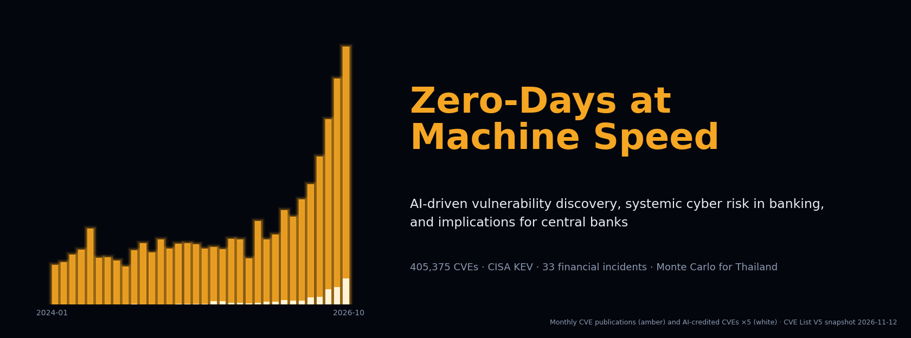
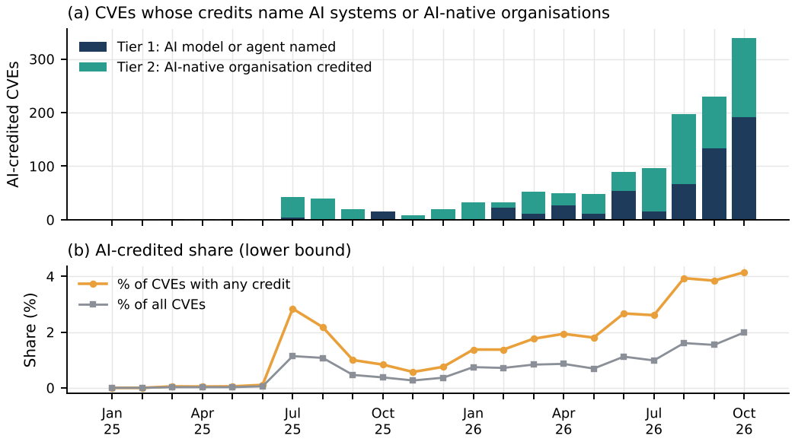
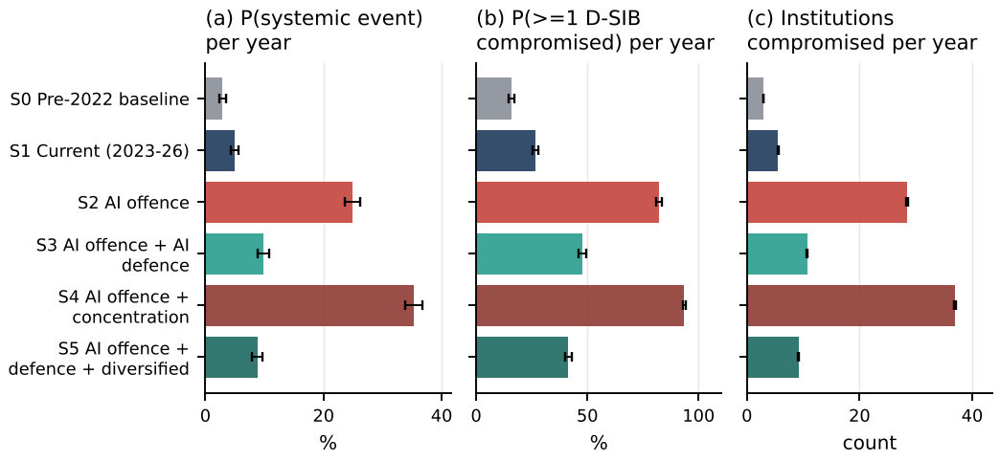

<p align="center"><a href="paper.pdf"></a></p>

<p align="center">
<a href="requirements.txt"></a>
<a href="https://thanatchon36.github.io/ai-zeroday-banking/paper/"></a>
<a href="paper.pdf"></a>
<a href="paper/"></a>
<a href="#data-sources"></a>
<a href="LICENSE"></a>
<a href="LICENSE"></a>
<a href="https://zenodo.org/badge/latestdoi/1456110038"></a>
<a href="https://huggingface.co/datasets/thanatchon36/ai-zeroday-banking"></a>
<a href="https://huggingface.co/thanatchon36/ai-zeroday-banking"></a>
</p>

<p align="center">
📖 <b><a href="https://thanatchon36.github.io/ai-zeroday-banking/paper/">Read the paper online</a></b> ·
📄 <b><a href="paper.pdf">Download the PDF</a></b> ·
📝 <b><a href="paper/">LaTeX source</a></b> ·
🔢 <b><a href="outputs/key_numbers.json">Key numbers</a></b> ·
🗂️ <b><a href="data/curated/">Curated data</a></b> ·
🤗 <b><a href="https://huggingface.co/datasets/thanatchon36/ai-zeroday-banking">Dataset</a></b> ·
🧮 <b><a href="https://huggingface.co/thanatchon36/ai-zeroday-banking">Model</a></b> ·
📣 <b><a href="docs/linkedin_post.md">LinkedIn post</a></b>
</p>

**AI-driven vulnerability discovery, systemic cyber risk in banking, and implications for central banks**,
measured from the full CVE List V5 (405,375 records) and the CISA Known Exploited Vulnerabilities catalogue
(1,779 entries), with 33 curated financial-sector incidents and a group-level scenario framework for Thailand.
The pipeline flags AI-credited CVEs, builds a KEV exploitation panel and a zero-day proxy, and runs a Monte Carlo
model of a Thai-like banking system under AI offence and defence scenarios.



> **Verify before citing.** The curated files (`financial_incidents.csv`, `hardware_trust_anchors.csv`,
> `ai_milestones.csv`, `zero_day_benchmarks.csv`) and several bibliography entries were compiled without
> live web access. Check dates, amounts, attributions and reference details against primary sources.

## Headline results

| Finding | Number |
|---|---|
| CVE publications, Jan–Oct 2026 vs 2025 | **2.27×** (Chrome ×33, Oracle ×13, Microsoft ×4) |
| CVEs crediting an AI system or AI-native firm | **1,598**, doubling about every **4 months** |
| Severity, AI- vs human-credited (mean CVSS) | 6.93 vs 6.98 (Mann–Whitney p = 0.66) |
| Within-180-day exploitation per 1,000 new CVEs | fell from 3.9 to **2.6** |
| AI-credited CVEs in KEV | **15**, mostly n-days |
| KEV zero-day proxy vs industry counts, 2022–2024 | within **7%** |
| Systemic payment disruption, 3× AI offence | about **5×** (4.0–6.8×) annual probability |
| AI-enabled defence / vendor concentration | removes 50–75% of the increase / adds 36–64% |

## Install and quickstart

```bash
pip install -r requirements.txt
bash run_all.sh        # fetch data if absent -> s01..s09 -> paper.pdf   (under 10 minutes)
```

One CPU core, 3 GB RAM, fixed seeds. LaTeX (TeX Live) is needed only for the last step. A later download gives a
later snapshot, so counts will move.

| Step | Purpose |
|---|---|
| `s00_fetch_data.sh` | Download CVE List V5 bulk release and CISA KEV into `data/raw/` |
| `s01_extract_cve.py` | Flatten 405k CVE JSON records into a table |
| `s02_ai_credits.py` | Flag AI-credited CVEs (two tiers) with the lexicon and exclusions |
| `s03_kev_panel.py` | KEV panel: categories, vendors, publication-to-exploitation lags |
| `s04_analysis.py` | Volume, surge, growth, severity and lag statistics → `key_numbers.json` |
| `s05_cases.py` | Financial-sector incidents and hardware trust-anchor cases |
| `s06_thai_framework.py` | Group-level exposure scoring for Thailand |
| `s07_simulation.py` | Monte Carlo of a Thai-like system calibrated to KEV rates |
| `s08_figures.py` | All figures (PNG to `outputs/figures/`, PDF to `paper/figures/`) |
| `s09_latex_tables.py` | LaTeX tables in `paper/tables/` |

## What the pipeline does

1. **CVE extraction**: every published record in CVE List V5 (snapshot 2026-11-12), with vendor, product, CWE,
   CVSS and credit fields.
2. **AI attribution** (`data/curated/ai_credit_lexicon.csv`, `ai_credit_exclusions.csv`): tier 1 names an AI
   system in the credit; tier 2 credits an AI-native firm. Exclusions remove false matches.
3. **Exploitation panel**: CISA KEV joined to CVE publication dates; rule-based categories
   (`kev_category_rules.csv`) and banking-relevance weights (`banking_relevance.csv`) give a bank-weighted
   exploitation pressure series.
4. **Zero-day proxy**: KEV entries added on or before CVE publication, checked against industry benchmark
   counts (`zero_day_benchmarks.csv`).
5. **Cases**: 33 financial-sector incidents classified by vector (zero-day, n-day, supply chain, credentials).
6. **Thai framework and simulation**: group-level scores (`thai_groups.csv`), then a Monte Carlo over AI offence,
   AI defence and vendor concentration scenarios.
7. **Paper**: every table, figure and quoted number is written by the code.

## Research: *Zero-Days at Machine Speed*

The paper by Thanatchon Chongmankhong is [`paper.pdf`](paper.pdf), with LaTeX source in [`paper/`](paper/)
(`main.tex`, `body1.tex`, `body2.tex`, `appendix.tex`, `refs.bib`, `main.bbl`). arXiv category cs.CR, cross-listed
cs.AI and q-fin.RM; the abstract under arXiv's 1,920-character limit is in [`abstract_arxiv.txt`](abstract_arxiv.txt).
It draws ten implications for central banks.

- Tables: [`outputs/tables/`](outputs/tables/) · Figures: [`outputs/figures/`](outputs/figures/)
- Every number in the text: [`outputs/key_numbers.json`](outputs/key_numbers.json)
- Web reader: <https://thanatchon36.github.io/ai-zeroday-banking/paper/>, built from `paper/main.tex` by
  `src/s11_web_reader.py` (pandoc) into `docs/paper/` and served by GitHub Pages
- Dataset on Hugging Face: [`thanatchon36/ai-zeroday-banking`](https://huggingface.co/datasets/thanatchon36/ai-zeroday-banking),
  with AI flags for all 405,375 CVEs, the AI-credited subset, the KEV panel, simulation draws, curated inputs and every table
- Model card on Hugging Face: [`thanatchon36/ai-zeroday-banking`](https://huggingface.co/thanatchon36/ai-zeroday-banking),
  with the simulation's constants (`model_specs.json`), scenarios and code. It holds no weights: the model is a
  parametric Monte Carlo with a fixed seed

<p align="center"></p>

## Repository layout

```
src/
  s00_fetch_data.sh         download CVE List V5 + CISA KEV
  s10_banner.py             dark README banner -> docs/assets/banner.png
  s11_web_reader.py         web reader -> docs/paper/index.html (GitHub Pages)
  s12_linkedin_poster.py    LinkedIn poster -> docs/assets/linkedin_poster.png (Fira Sans, OFL)
  s01..s09_*.py             extract, AI credits, KEV panel, analysis, cases, Thai framework,
                            simulation, figures, LaTeX tables
run_all.sh                  the whole pipeline end to end
data/curated/               lexicon, exclusions, KEV rules, banking weights, incidents,
                            hardware cases, AI milestones, Thai groups, zero-day benchmarks
data/processed/             AI flags for all CVEs, AI-credited subset, KEV panel, simulation draws
outputs/tables/, figures/   every table (CSV) and figure (PNG) in the paper
outputs/key_numbers.json    every number quoted in the text
paper/                      LaTeX source, generated tables/ and figures/
paper.pdf                   compiled paper
```

## Data sources

* CVE List V5 bulk release: <https://github.com/CVEProject/cvelistV5> (snapshot 2026-11-12)
* CISA Known Exploited Vulnerabilities: <https://github.com/cisagov/kev-data> (catalogue 2026.11.10)

## Ethics and scope

Public data only. No exploit code, no proof-of-concept, no scanning or testing of any system, and no assessment
of any named Thai institution. The Thai analysis is group-level structured judgement.

## Limitations

Credit fields cover only part of CVEs (43% in 2026), so AI counts are lower bounds; KEV records exploitation that
CISA knows of, not all exploitation; the incident set is small and hand-curated; the simulation is a stylised
Thai-like system, not Thailand. See the paper's limitations section.

## Citation

See [`CITATION.cff`](CITATION.cff); each release is archived on Zenodo (DOI badge above). License: code MIT; paper, figures and curated data CC BY 4.0
(see [`LICENSE`](LICENSE)).
