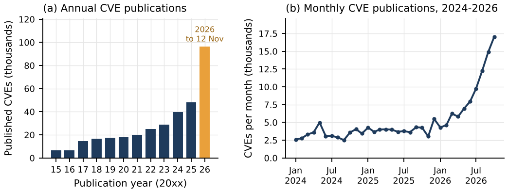
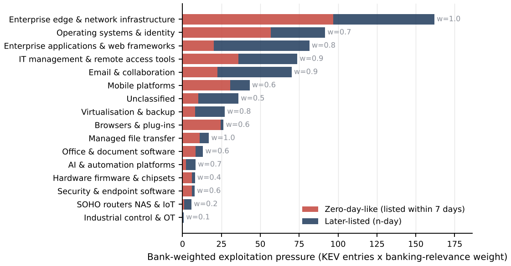

# Zero-Days at Machine Speed

**AI-Driven Vulnerability Discovery, Systemic Cyber Risk in Banking, and Implications for Central Banks — Evidence from 405,375 CVE Records and the CISA KEV Catalogue, with Scenarios for Thailand**

Author: Thanatchon Chongmankhong · Preprint, 12 November 2026 · arXiv category: cs.CR (cross-list cs.AI, q-fin.RM)

## Contents

| Path | What it is |
|---|---|
| `paper.pdf` | Compiled paper |
| `paper/` | LaTeX source (`main.tex`, `body1.tex`, `body2.tex`, `appendix.tex`, `refs.bib`, generated `tables/`, `figures/`) |
| `src/` | Pipeline `s00`–`s09` (fetch → extract → classify → analyse → cases → Thai framework → simulation → figures → LaTeX tables) |
| `data/curated/` | Hand-built inputs: AI-credit lexicon and exclusions, KEV category rules, banking-relevance weights, incident set, hardware cases, AI milestones, Thai group scores, zero-day benchmarks |
| `data/processed/` | Derived data (AI flags for all CVEs, AI-credited subset, KEV panel, simulation draws) |
| `outputs/tables/`, `outputs/figures/` | Every table (CSV) and figure (PNG) in the paper; PDF figures live in `paper/figures/` |
| `outputs/key_numbers.json` | Every number quoted in the text, written by the code |
| `abstract_arxiv.txt` | Abstract under arXiv's 1,920-character limit |

## Key figures






## Reproduce

```bash
pip install -r requirements.txt
bash run_all.sh        # downloads public data if absent, runs s01–s09, compiles paper.pdf
```

Runtime is under ten minutes on one CPU core with 3 GB RAM. Seeds are fixed. A later download gives a later snapshot, so counts will move.

## Data sources

* CVE List V5 bulk release — https://github.com/CVEProject/cvelistV5 (snapshot 2026-11-12)
* CISA Known Exploited Vulnerabilities — https://github.com/cisagov/kev-data (catalogue 2026.11.10)

## Ethics and scope

Public data only. No exploit code, no proof-of-concept, no scanning or testing of any system, and no assessment of any named Thai institution. The Thai analysis is group-level structured judgement.

## Before publishing — please verify

The curated files (`financial_incidents.csv`, `hardware_trust_anchors.csv`, `ai_milestones.csv`, `zero_day_benchmarks.csv`) and several bibliography entries were compiled from the author's and an AI assistant's knowledge without live web access. Check dates, amounts, attributions and reference details against primary sources before submission.

## Uploading to GitHub

```bash
cd ai-zeroday-banking
git init
git add .
git commit -m "Zero-Days at Machine Speed: paper, code and data"
git branch -M main
git remote add origin https://github.com/<your-username>/ai-zeroday-banking.git
git push -u origin main
```

The GitHub web uploader accepts at most 100 files per upload. This repository has a little over 100, so if you upload through the browser, do it in two batches (for example everything except `paper/` first, then `paper/`).

## Submitting to arXiv

Upload the contents of `paper/` (`main.tex`, `body1.tex`, `body2.tex`, `appendix.tex`, `refs.bib`, `main.bbl`, `figures/`, `tables/`) and paste `abstract_arxiv.txt` into the abstract field.
